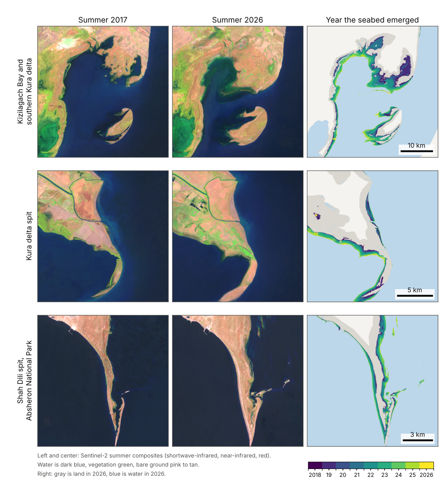
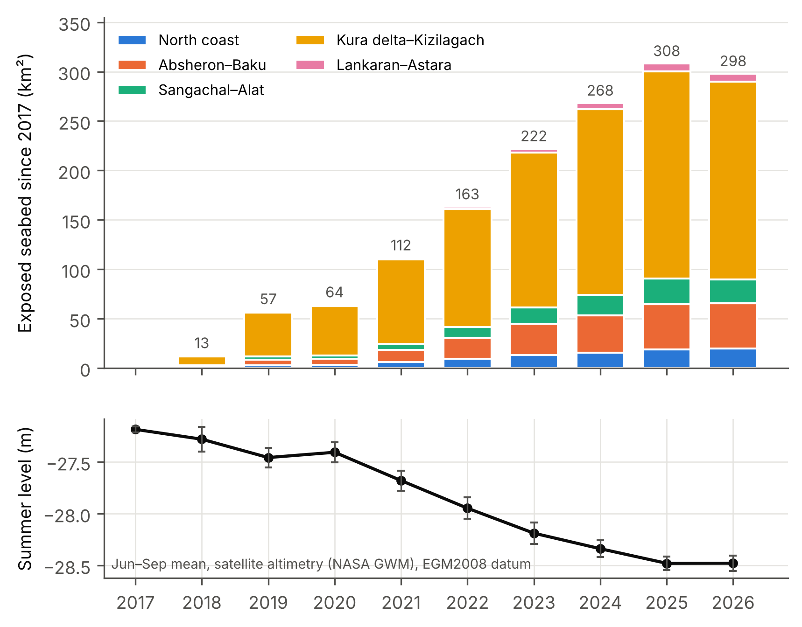

# Newly exposed Caspian seabed along Azerbaijan's coast, 2017–2026

[](https://github.com/mediina13/Caspian-Exposed-Seabed/actions/workflows/reproduce.yml)
[](https://doi.org/10.5281/zenodo.24141016)


The Caspian Sea is falling, and each meter of fall turns a strip of seabed into land.
This repository maps that new land along the whole coast of Azerbaijan for every summer
from 2017 to 2026, using Sentinel-2 imagery in Google Earth Engine. It then measures how
the exposed area follows sea level, what grows on the new ground, and which protected
sites and how many people are next to it.

Everything needed to check the results is here: the Earth Engine scripts, the tables they
produce, the Python scripts that turn those tables into statistics and figures, and tests
that confirm the headline numbers.



*Three sites on the coast. Left and center: Sentinel-2 summer composites for 2017 and 2026.
Right: new ground colored by the year it emerged. Contains modified Copernicus Sentinel data.*

## Main results

| Question | Result |
|---|---|
| How much seabed dried out from 2017 to 2026? | 298 km², two thirds of it in the Kura delta and Kizilagach Bay |
| How far did the summer sea level fall? | 1.29 m (satellite altimetry) |
| How much seabed dries per meter of fall? | 234 ± 7 km² for the whole coast, from 156 km² on the Kura delta shelf to 6 km² at Lankaran–Astara |
| How much has emerged since the 2005 high stand? | About 425 km² (Landsat record joined to the Sentinel-2 maps) |
| How far did the shoreline move? | Median 208 m. In the Kura delta–Kizilagach zone the median is 752 m and the maximum 6.8 km |
| Is the map right? | 95.5 ± 6.2% of mapped exposure is confirmed by 150 stratified reference points. The area-adjusted estimate is 346 ± 61 km² |
| What does the seabed become? | Bare seabed stays bare for at least seven years on the northern and central coast. In the south it is vegetated within a year |
| How much is still bare in 2026? | 71 km² (24%), and 81% of that is on the northern and central coast |
| How much lies inside protected sites? | 60% of the exposed seabed |
| How many people live near bare seabed? | 1.37 million within 5 km (GHS-POP 2020) |



## Repository layout

```
gee/                      Google Earth Engine scripts (JavaScript)
  01_exposed_seabed.js      water maps, exposure, vegetation, sensitivity, accuracy sample
  02_extended_analysis.js   long-term record, retreat, protected areas, population, depth test
analysis/                 Python scripts that build every table and figure
  01_exposure_and_sea_level.py
  02_accuracy.py
  03_extended.py
  04_map_figure.py
  05_study_area_map.py      study area map (needs basemap, see below)
  06_workflow_diagram.py    workflow diagram
  common.py                 shared paths and figure style
data/                     inputs to the Python scripts (see data/README.md)
  earth_engine/             tables printed by gee/01_exposed_seabed.js
  earth_engine_extended/    tables printed by gee/02_extended_analysis.js
  sea_level/                Caspian altimetry series (NASA Global Water Monitor)
  accuracy/                 150 sample points and their reference labels
  map_panels/               image panels for the before/after figure
results/
  tables/                   19 output tables
  figures/                  13 figures
docs/methods.md           methods, settings and limits in one page
tests/                    checks on the headline numbers
```

## Reproduce the tables and figures

The Python part needs no Earth Engine account. It starts from the tables in `data/`.

```bash
git clone https://github.com/mediina13/Caspian-Exposed-Seabed.git
cd Caspian-Exposed-Seabed
python -m venv .venv && source .venv/bin/activate     # Windows: .venv\Scripts\activate
pip install -r requirements.txt
make all        # rebuilds results/tables and results/figures
make test       # checks the headline numbers
```

Without `make`, run the four scripts in order:

```bash
python analysis/01_exposure_and_sea_level.py
python analysis/02_accuracy.py
python analysis/03_extended.py
python analysis/04_map_figure.py
python -m pytest -q
```

The same steps run on every push through GitHub Actions (`.github/workflows/reproduce.yml`).

Two more figures, the study area map and the workflow diagram, are not part of `make all`.
The map needs two extra packages:

```bash
pip install basemap basemap-data-hires
python analysis/05_study_area_map.py     # or: make studyarea
python analysis/06_workflow_diagram.py   # or: make workflow
```

## Reproduce the satellite analysis

The tables in `data/earth_engine*/` come from the two scripts in `gee/`. To rerun them you
need a Google Earth Engine account with a Cloud project. `gee/README.md` gives the steps.
In short: paste `01_exposed_seabed.js` into the Code Editor, point `ASSET_DIR` at your own
project, run the two export tasks it creates, then run both scripts and copy the tables
they print.

## Method in brief

1. **Water maps.** For each summer (June to September), a pixel is water when MNDWI is
   above zero in at least half of its clear Sentinel-2 observations.
2. **Exposed seabed.** A pixel is exposed in a year when it was water in 2017 and is land
   in that year. The year of emergence is the first year from which it stays land.
3. **Screening.** Coastal ponds and fields landward of the c. 2000 shoreline, and new
   built-up land, are set aside.
4. **Accuracy.** A stratified random sample of 150 points, labeled without sight of the
   mapped class, gives accuracy and an area-adjusted estimate.
5. **Sea level.** Exposed area is regressed on the fall in summer level from satellite
   altimetry, for the whole coast and for five zones.
6. **Vegetation.** Peak NDVI follows each patch of new ground from the year it emerged.
7. **Context.** The maps are overlaid on protected areas, a population grid and a depth grid.

Details, settings and limits are in [docs/methods.md](docs/methods.md).

## Data sources

| Data | Earth Engine ID or source | Used for |
|---|---|---|
| Sentinel-2 Level-1C | `COPERNICUS/S2_HARMONIZED` | Summer water maps, 2017–2026 |
| Sentinel-2 Level-2A | `COPERNICUS/S2_SR_HARMONIZED` | NDVI and MSAVI, 2019–2026 |
| Cloud Score+ | `GOOGLE/CLOUD_SCORE_PLUS/V1/S2_HARMONIZED` | Cloud and shadow masking |
| HydroLAKES v1.0 | `projects/sat-io/open-datasets/HydroLakes/lake_poly_v10` | Sea outline, c. 2000 |
| JRC Global Surface Water v1.4 | `JRC/GSW1_4/YearlyHistory` | Landsat record, 1998–2021 |
| Dynamic World v1 | `GOOGLE/DYNAMICWORLD/V1` | Built-up land |
| World Database on Protected Areas | `WCMC/WDPA/current/polygons` | Protected and designated sites |
| GHS-POP R2023A | `JRC/GHSL/P2023A/GHS_POP/2020` | Population, 2020 |
| GEBCO 2023 grid | `projects/sat-io/open-datasets/gebco/gebco_grid` | Seabed height |
| NASA Global Water Monitor, lake 000270 | https://earth.gsfc.nasa.gov/gwm/lake/270 | Caspian sea level, 1992–2026 |

## Limits to keep in mind

- Reed beds in shallow water read as land, so part of the exposure in the south may be
  standing vegetation over water.
- The reference labels come from one interpreter working with 10 to 20 m imagery.
- The vegetation record starts in 2019, and the seven-year point rests on one cohort.
- The projection for larger falls uses a coarse depth grid and gives a range only.
- The population figures count people by distance. They do not measure dust.

## How to cite

If you use the code or the tables, please cite this repository. GitHub shows the citation
under "Cite this repository", taken from [CITATION.cff](CITATION.cff). Each release is
archived on Zenodo. The DOI below covers all versions and resolves to the latest one.

> Ziyadkhanova, M. (2026). *Newly exposed Caspian seabed along Azerbaijan's coast,
> 2017–2026: code and data* (version 1.0.0). Zenodo.
> https://doi.org/10.5281/zenodo.24141016

## License

Code is released under the [MIT License](LICENSE). Tables and figures are released under
[CC BY 4.0](LICENSE-DATA.md). Input datasets keep the licenses of their providers.

## Contact

Medina Ziyadkhanova, Baku Higher Oil School, Baku, Azerbaijan
(ORCID [0009-0002-1426-8342](https://orcid.org/0009-0002-1426-8342)). Questions and corrections
are welcome through the repository's issue tracker.
